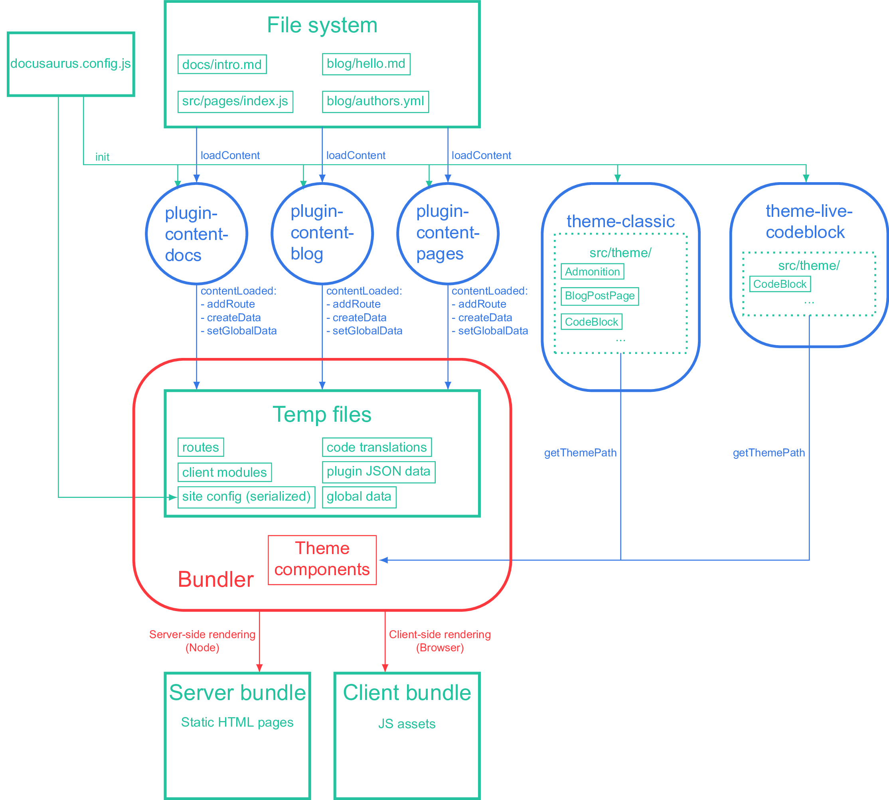

# Markdown 写作参考（纯 .md 示例）

本页用**纯标准 Markdown**（`.md`）编写，所有语法均已在 `doc.legspcpd.top` 验证可用。 **唯一限制**：`.md` 里不能写 JSX 组件（如 `<Tabs>`、`<Admonition>`）；需要组件时再改用 `.mdx`。

> 复制本文件、改掉 `title` 和正文，再在 `sidebars.ts` 加一行 id（去掉 `.md`），即可成为你自己的文档。

## 1. 标题层级

`#` 到 `######` 对应 h1–h6。h1 建议全篇只有一个（即页面主标题）。

```md
# 一级标题（页面主标题，通常自动生成）

## 二级标题（章节）

### 三级标题（小节）
```

## 2. 文字样式

**加粗**、_斜体_、_**加粗斜体**_、`行内代码`、~~删除线~~。上下标：H`2`O（下标用 HTML `<sub>`）、x`<sup>`2`</sup>`。

键盘按键示例：按 `<kbd>Ctrl</kbd> + <kbd>C</kbd>` 复制。

## 3. 列表

### 无序列表

- 第一项
- 第二项
  - 嵌套 A
  - 嵌套 B
    - 三层嵌套
- 第三项

### 有序列表

1. 第一步
2. 第二步
   1. 子步骤 2.1
   2. 子步骤 2.2
3. 第三步

### 任务清单（复选框）

- [x] 已完成事项
- [ ] 未完成事项
- [ ] 另一个待办

## 4. 代码块

标注语言即可语法高亮。注意：本站的 `npm2yarn` 插件会把 `bash` 里的 `npm` 命令自动转成 `yarn` 展示。

```bash
npm install
npm run build
```

```ts
interface User {
  id: number;
  name: string;
}

function greet(user: User): string {
  return `Hello, ${user.name}!`;
}
```

```json
{"primary": "#21c45d", "hue": 142}
```

## 5. 表格

| 语法元素            | `.md` 是否支持 | 备注                    |
| ------------------- | :------------: | ----------------------- |
| 标准 Markdown       |       ✅       | 标题/列表/代码/引用     |
| 表格                |       ✅       | 第二行定义对齐          |
| 提示框（`:::note`） |       ✅       | Docusaurus 指令，非 JSX |
| 数学公式            |       ✅       | 需 KaTeX，本已开启      |
| JSX 组件            |       ❌       | 需改用 `.mdx`           |

对齐写法：`:---:` 居中，`---:` 右对齐，`:---` 左对齐。

## 6. 链接与图片

### 外部链接

[Docusaurus 官网](https://docusaurus.io) ｜ [GitHub](https://github.com/facebook/docusaurus)

### 站内文档链接（推荐用相对文档 id，避免写死版本前缀）

详见 [Installation](./installation.mdx)。

### 图片


带尺寸的图片：



> 图片统一放在 `website/static/img/` 下，文档里用 `/img/文件名` 引用。

## 7. 引用块

> 这是一级引用。
>
> > 这是嵌套引用。

## 8. 提示框（Admonitions）

用 `:::类型` 开启，`:::` 结束。支持 `note` / `tip` / `info` / `caution` / `danger`，以及本站自定义关键字 `my-custom-admonition`。

:::note普通说明框。用于补充背景信息。:::

:::tip小技巧：改完文档后推送到 `docs` 远端，约两分钟自动上线。:::

:::info 信息框：本示例完全不依赖 React 组件。:::

:::caution注意：`.md` 中不要写 `<Tabs>` 之类的 JSX，否则构建会报错。:::

:::danger 危险框：不要把密钥、Token 写进文档。:::

:::my-custom-admonition 自定义提示框（在你的 config 里通过 `admonitions.keywords` 注册过）。:::

## 9. 折叠块（HTML `<details>`）

`<details>` 是原生 HTML，在 `.md` 里可直接使用：

<details>
  <summary>点击展开看更多</summary>

这里是折叠内容，可以放任意 Markdown 文本、代码、表格。

```bash
echo "hidden content"
```

</details>

## 10. 数学公式（KaTeX）

行内公式：勾股定理 `a^2 + b^2 = c^2`。

块级公式：

```
\int_a^b f(x)\,dx = F(b) - F(a)
```

## 11. 分割线与脚注

---

这是带脚注的句子。[^1]

[^1]: 脚注内容会显示在页面底部。

## 12. 快速上手模板

1. 在 `website/docs/` 下新建 `你的文档.md`。
2. 顶部写 front matter（至少 `title`）。
3. 在 `website/sidebars.ts` 的 `docs` 数组里加一行 `'你的文档'`。
4. 提交并推送到 `docs` 远端：

```bash
git add website/docs/你的文档.md website/sidebars.ts
git commit -m "docs: 新增文档 (AI-assisted)"
git push docs main
```

5. 访问 `https://doc.legspcpd.top/docs/next/你的文档`。
