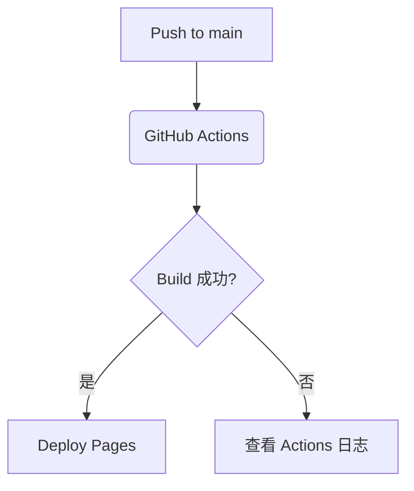

# 测试页：Markdown 特性

## 提示框

:::tip
这是一个 tip 提示框。
:::

:::warning
这是一个 warning 提示框。
:::

:::danger
这是一个 danger 提示框。
:::

## 标签页

```tabs
```bash
npm run build
```

```pnpm
pnpm build
```
```

## 流程图 (Mermaid)


