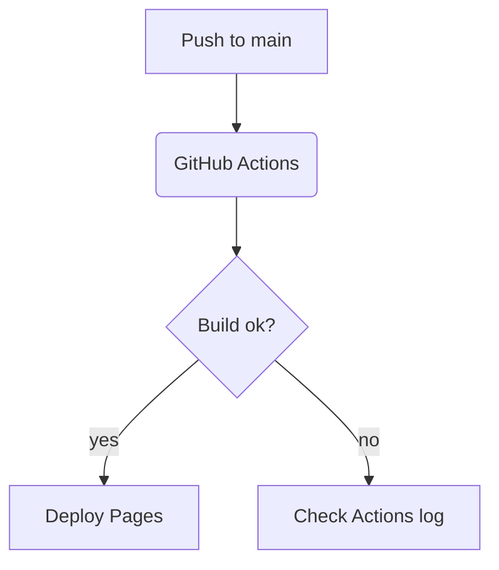

# Test Page: Markdown Features

## Admonitions

:::tip
This is a tip admonition.
:::

:::warning
This is a warning admonition.
:::

## Tabs

```tabs
```bash
npm run build
```

```pnpm
pnpm build
```
```

## Diagram (Mermaid)


